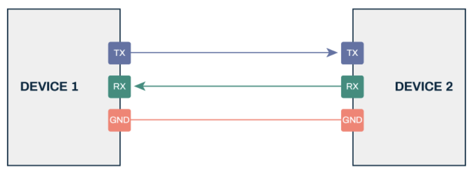
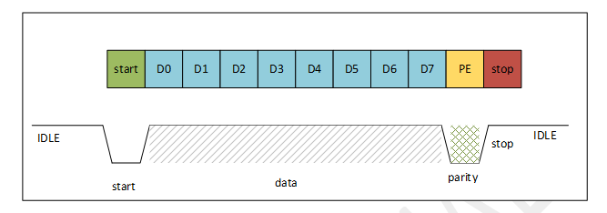
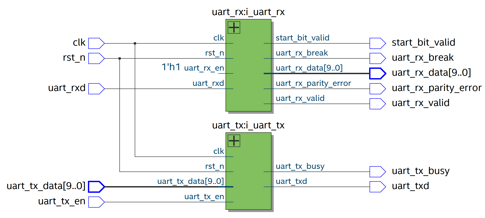
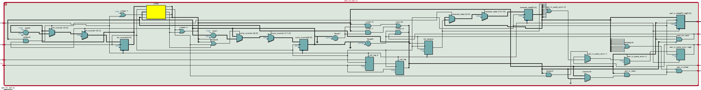
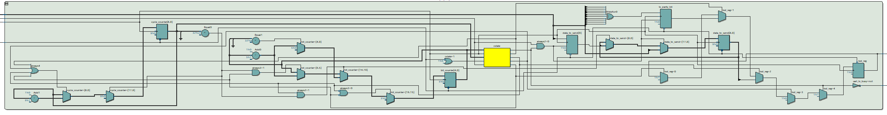
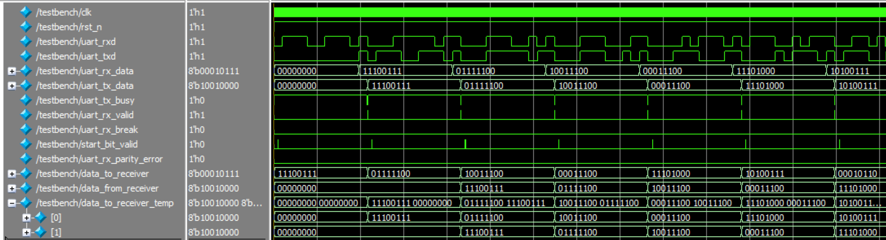

# UART
A parameterizable full-duplex UART transceiver implemented in Verilog with verification using SystemVerilog Testbench.

Clone the Repo:
```
git clone https://github.com/pletnevAE/UART.git
```

## Contents
- [Overview](#overview)
- [Theoretical basis](#theoretical-basis)
- [Architecture](#architecture)
- [Interface](#interface)
  - [Parameters](#parameters)
  - [Signals](#signals)
- [Utilization](#utilization)
- [Simulation](#simulation)
- [Building the project out-of-the-box](#building-the-project-out-of-the-box)

## Overview
The module implements a full-duplex UART transceiver deisgned for reliable serial data transmissiom in FPGA-based digital processing systems.

Typical applications:
+ receiving and transmitting data from terminal, PC, or microcontroller;
+ system logging and debugging via serial interface;
+ inter-board serial data links within FPGA systems.

## Theoretical basis
The UART (Universal Asynchronous Receiver-Transmitter) protocol provides asynchronous serial communication using two independent data lines: `TXD` (transmit) and `RXD` (receive). Since a common clock signal is not transmitted alogside the data, receiver clock recovery is syncronized to the falling edge of the start bit.

<p align="center">
  
</p>

UART Frame Structure:
+ Start bit: transitions the line from idle state (logic `1`) to logic `0` for one bit period.
+ Payload bits: bit sequence of a given length, transmitted Least Significant Bit first (LSB-first).
+ Parity bit (optional): used to detect signle-bit transmission errors.
+ Stop bit: holds the line at logic `1` for a specified number of bits to mark frame completion and restore the idle state.

<p align="center">
  
</p>

The bit period $T_{bit}$ is determined by the configured Baud rate:

$$T_{bit} = \frac{1}{\mathrm{BIT\_RATE}}$$

The number of clock cycles per single bit period $N_{cycles}$ for system clock frequency $f_{clk}$ is calculated as:

$$N_{cycles} = \left\lfloor \frac{f_{clk}}{\mathrm{BIT\_RATE}} \right\rfloor$$

To sample data reliably, the receiver counts $\frac{N_{cycles}}{2}$ from the detected falling edge of the start bit and samples the incoming data line precisely at the midpoint of each bit cell.

The parity bit $P$ for data payload $D = [D_{N - 1}, \dots, D_0]$ is computed as follows:
+ **Even Parity**: ensures the total count of logic `1`s in the frame is even:

$$P_{even} = D_0 \oplus D_1 \oplus \dots \oplus D_{N - 1} = \bigoplus_{i = 0}^{N - 1} D_i$$

+ **Odd Parity**: ensures the total count of logic `1`s in the frame is odd:

$$P_{odd} = \sim \left(\bigoplus_{i = 0}^{N - 1} D_i \right)$$

Upon reception, the computed parity value is evaluated against the incoming parity bit. Any mismatch triggers the parity error flag.

## Architecture
The UART transceiver architecture consists of three modules:
1. **UART top-level module**: instantiates the receiver and transmitter modules.

<p align="center">
  
</p>

2. **UART receiver module**: responsible for receiving data, and checking the start bit and parity bit.

<p align="center">
  
</p>

3. **UART transmitter module**: responsible for data transmission and parity bit generation.

<p align="center">
  
</p>

Key implementation features:
+ asynchronous Active-Low reset (`rst_n`);
+ parameterization;
+ receiver and transmitter employ dedicated state machines;
+ configurable Even/Odd parity bit generation and checking with dedicated `uart_rx_parity_error` flag;
+ start bit validation;
+ two-stage flip-flop synchronizer on `uart_rxd` line to prevent metastability;
+ LSB-first transmission and reception order.

## Interface
### Parameters
| Parameter | Default Value | Description |
|:--:|:--:|:--:|
| `CLK_HZ` | 50000000 | Clock signal frequency |
| `BIT_RATE` | 256000 | Baud rate (bits per second) |
| `PAYLOAD_BITS` | 8 | Number of payload data bits |
| `STOP_BITS` | 1 | Number of stop bits |
| `PARITY_ENABLE` | 1 | Parity handling enable (0 - disable, 1 - enable) |
| `PARITY_TYPE` | 0 | Parity type selector (0 - even, 1 - odd) |

### Signals
| Port | Direction | Width | Description |
|:--:|:--:|:--:|:--:|
| `clk` | Input | 1 | Clock signal |
| `rst_n` | Input | 1 | Asynchronous Active-Low Reset |
| `uart_rxd` | Input | 1 | UART RX signal |
| `uart_tx_data` | Input | `PAYLOAD_BITS` | Transmitted data |
| `uart_tx_en` | Input | 1 | Transmission enable signal from the FPGA |
| `uart_txd` | Output | 1 | UART TX signal |
| `uart_tx_busy` | Output | 1 | Data transfer is in progress |
| `uart_rx_valid` | Output | 1 | The received data is saved |
| `uart_rx_break` | Output | 1 | RX break |
| `uart_rx_parity_error` | Output | 1 | RX parity error |
| `uart_rx_data` | Output | `PAYLOAD_BITS` | Transmitted data |
| `start_bit_valid` | Output | 1 | Start bit valid signal |

## Utilization
The project was synthesized for the 10M50DAF484C6GES FPGA on the DE10-Lite board using Quartus 22.1 Standard Edition. For `CLK_HZ = 50000000`, `BIT_RATE = 256000`, `PAYLOAD_BITS = 8`, `STOP_BITS = 1`, `PARITY_ENABLE = 1`, `PARITY_TYPE = 0` the following results were obtained:
| FPGA | LUT | FF | Fmax, MHz | Hold Slack, ns | Setup Slack, ns |
|:--:|:--:|:--:|:--:|:--:|:--:|
| 10M50DAF484C6GES | 130 | 74 | 231.11 | 0.324 | 15.673 |

## Simulation
Simulation is performed in ModelSim 10.6d using the SystemVerilog testbench (**testbench.sv**). The testbench verifies full-duplex transaction integrity using randomized data packets.

| Parameter | Default Value | Description |
|:--:|:--:|:--:|
| `CYCLES` | 20 | Number of test iterations |
| `RESET_CYCLES` | 10 | Number of clock cycles before reset release |
| `CLK_HZ` | 50000000 | Clock signal frequency |
| `BIT_RATE` | 256000 | Baud rate (bits per second) |
| `PAYLOAD_BITS` | 8 | Number of payload data bits |
| `STOP_BITS` | 1 | Number of stop bits |
| `PARITY_ENABLE` | 1 | Parity handling enable (0 - disable, 1 - enable) |
| `PARITY_TYPE` | 0 | Parity type selector (0 - even, 1 - odd) |

The testbench checks:
1. match between transmitted and received payload data;
2. parity generation on TX, parity verification on RX, and absence of spurious `uart_rx_parity_error` flags;
3. Baud rate tolerance within $\pm 5\%$ of configured speed.

If errors are detected, the total error count is displayed upon completion. If successful, the testbench outputs:

```
UART MODULE TESTS PASSED!
```
Waveforms window:
<p align="center">
  
</p>

Verification is also performed using scripts implemented for building the project out-of-the-box. In this case, the verification results are output to the console.
```
# [9189100] [SUCCESS] Data to Receiver: 110010110; Received Data: 110010110.
# [9189100] [SUCCESS] Data from Receiver: 11011110; Expected Data: 11011110.
# [9189100] [SUCCESS] TX Parity bit: 0; Expected: 0.
# [9189100] [SUCCESS] Baud Rate = 254902, correct.
# [9699500] [SUCCESS] Data to Receiver: 10010000; Received Data: 10010000.
# [9699500] [SUCCESS] Data from Receiver: 110010110; Expected Data: 110010110.
# [9699500] [SUCCESS] TX Parity bit: 1; Expected: 1.
# [9699500] [SUCCESS] Baud Rate = 254902, correct.
# [10209900] [SUCCESS] Data to Receiver: 100010111; Received Data: 100010111.
# [10209900] [SUCCESS] Data from Receiver: 10010000; Expected Data: 10010000.
# [10209900] [SUCCESS] TX Parity bit: 0; Expected: 0.
# [10209900] [SUCCESS] Baud Rate = 254902, correct.
#
#
# [10209900] [PASS] UART MODULE TESTS PASSED!
```

## Building the project out-of-the-box
Scripts **run_build.bat**, **build.tcl**, **timing.tcl** and **sim.tcl** are implemented for building the project out-of-the-box. The scripts perform project synthesis and fitting, Static Timing Analysis (STA), and verification using a testbench. For the scripts to work, the path to the **bin64** folder within the Quartus root directory must be included in the `PATH` environment variable in Windows.

To run the script, you need to enter the following in the command line from the directory **tcl**:
```
run_build.bat <build_path> -CLK_HZ <value> -BIT_RATE <value> -PAYLOAD_BITS <value> -STOP_BITS <value> -PARITY_ENABLE <value> -PARITY_TYPE <value>
```

To get help on the script, you need to enter the following in the command line:
```
run_build.bat <build_path> --help
```

Setting the parameter flags is not necessary; if one of them (or all of them) is not set, the parameter will take on the default value.

The scripts output project build information, a Compilation Report, STA results and verification results to the console.